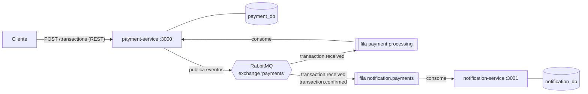
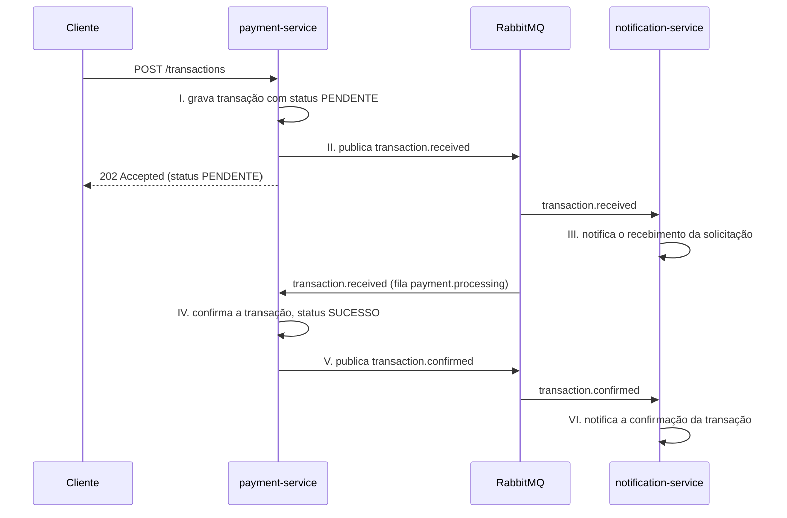

# CompreFácil – Microsserviços de pagamento e notificação

Desafio 2 da disciplina **Desenvolvimento de Sistemas Distribuídos** (UniSENAI).
Aluno: **Helio Paiva da Silva**

O projeto tem dois serviços independentes em Node.js que se comunicam de forma assíncrona pelo RabbitMQ:

- **payment-service** (porta 3000): recebe a solicitação de transação, grava no seu banco, confirma o pagamento e publica eventos.
- **notification-service** (porta 3001): consome os eventos da fila e notifica o usuário (envio de e-mail simulado no console), registrando o histórico no seu próprio banco.

Os dois serviços têm interface **REST** (Express) e **AMQP** (amqplib), e cada um usa o **seu próprio banco Postgres**. Um não chama o outro diretamente: eles só se conhecem pela mensageria.

## Arquitetura



## Fluxo da transação



O cliente recebe a resposta logo depois do passo II, com o código **202 (Accepted)**. Os passos seguintes acontecem em segundo plano, por mensagens. A confirmação (passo IV) espera alguns segundos para simular a resposta de um gateway de pagamento externo (`PROCESSING_DELAY_MS`, padrão 5 s).

## Tecnologias

- Node.js 18+ com Express 5
- PostgreSQL 16 (biblioteca `pg`)
- RabbitMQ 3 com painel de gerenciamento (biblioteca `amqplib`)
- Docker Compose

## Estrutura

```
.
├── docker-compose.yml          # Postgres + RabbitMQ (e os serviços, com --profile app)
├── docker/postgres/init.sql    # cria os bancos payment_db e notification_db
├── payment-service/
│   ├── src/index.js            # inicialização
│   ├── src/routes.js           # interface REST (passos I e II)
│   ├── src/processor.js        # consumidor AMQP (passos IV e V)
│   ├── src/rabbitmq.js         # conexão, publicação e consumo
│   └── src/db.js               # tabela transactions
└── notification-service/
    ├── src/index.js            # inicialização e consumidor AMQP
    ├── src/notifier.js         # monta e "envia" as notificações (passos III e VI)
    ├── src/routes.js           # interface REST
    ├── src/rabbitmq.js         # conexão e consumo
    └── src/db.js               # tabela notifications
```

## Como executar

Pré-requisitos: [Node.js 18 ou superior](https://nodejs.org) e [Docker Desktop](https://www.docker.com/products/docker-desktop/).

### Opção 1 – infraestrutura no Docker e serviços com npm (recomendada)

Assim fica fácil ver cada serviço rodando de forma independente, cada um no seu terminal.

**1. Subir o Postgres e o RabbitMQ** (na pasta raiz do projeto):

```bash
docker compose up -d
```

Espere uns 20 segundos na primeira vez, até o RabbitMQ terminar de iniciar.

**2. Serviço de pagamento** (terminal 1):

```bash
cd payment-service
npm install
cp .env.example .env        # no Windows (PowerShell): copy .env.example .env
npm start
```

**3. Serviço de notificação** (terminal 2):

```bash
cd notification-service
npm install
cp .env.example .env        # no Windows (PowerShell): copy .env.example .env
npm start
```

Cada serviço cria a sua tabela automaticamente na primeira execução.

### Opção 2 – tudo no Docker

```bash
docker compose --profile app up -d --build
docker compose logs -f payment-service notification-service
```

Para parar: `docker compose --profile app down`. Para apagar também os dados: acrescente `-v`.

## Testando o fluxo

**Criar uma transação** (bash / Git Bash):

```bash
curl -X POST http://localhost:3000/transactions \
  -H "Content-Type: application/json" \
  -d '{"userId":"10","userEmail":"cliente@teste.com.br","orderNumber":"1001","amount":150.50}'
```

No **PowerShell**:

```powershell
Invoke-RestMethod -Method Post -Uri http://localhost:3000/transactions -ContentType "application/json" `
  -Body '{"userId":"10","userEmail":"cliente@teste.com.br","orderNumber":"1001","amount":150.50}'
```

A resposta vem na hora, com status `PENDENTE`:

```json
{
  "message": "Solicitação de transação recebida. A confirmação será processada de forma assíncrona.",
  "transaction": { "id": "16a67732-...", "orderNumber": "1001", "amount": 150.5, "status": "PENDENTE" }
}
```

**Acompanhar o resultado:**

- `GET http://localhost:3000/transactions/<id>`: depois de alguns segundos o status muda para `SUCESSO`.
- `GET http://localhost:3001/notifications?userId=10`: mostra as duas notificações, `PAGAMENTO_RECEBIDO` e `PAGAMENTO_CONFIRMADO`.

Os logs dos terminais mostram cada passo do desafio:

```
[pagamento] Passo I - transação 16a67732-... gravada com status PENDENTE
[pagamento] Passo II - evento "transaction.received" publicado
[notificação] Passo III - notificando usuário 10 (transação 16a67732-...)
[notificação] E-mail enviado para: cliente@teste.com.br
[pagamento] Passo IV - transação 16a67732-... confirmada (status SUCESSO)
[pagamento] Passo V - evento "transaction.confirmed" publicado
[notificação] Passo VI - notificando usuário 10 (transação 16a67732-...)
[notificação] E-mail enviado para: cliente@teste.com.br
```

### Testando a independência dos serviços

1. Pare o serviço de notificação (`Ctrl+C` no terminal 2).
2. Crie uma nova transação. O pagamento continua funcionando normalmente e chega a `SUCESSO`.
3. No painel do RabbitMQ (http://localhost:15672, usuário `admin`, senha `123456`), aba **Queues**, a fila `notification.payments` mostra as mensagens esperando.
4. Inicie o serviço de notificação de novo (`npm start`). Ele lê as mensagens pendentes e envia as duas notificações.

## Endpoints

| Serviço | Método e rota | Descrição |
| --- | --- | --- |
| pagamento | `POST /transactions` | Recebe a solicitação de transação. Corpo: `userId`, `userEmail`, `orderNumber`, `amount`. Cabeçalho opcional `Idempotency-Key` |
| pagamento | `GET /transactions` | Lista as transações (filtro opcional `?userId=`) |
| pagamento | `GET /transactions/:id` | Consulta uma transação e o seu status |
| pagamento | `GET /health` | Verifica se o serviço está no ar |
| notificação | `GET /notifications` | Lista as notificações enviadas (filtros opcionais `?userId=` e `?transactionId=`) |
| notificação | `GET /health` | Verifica se o serviço está no ar |

## Mensageria (RabbitMQ)

| Elemento | Nome | Função |
| --- | --- | --- |
| Exchange (topic) | `payments` | Recebe os eventos publicados pelo serviço de pagamento |
| Chave | `transaction.received` | Solicitação de transação recebida (status PENDENTE) |
| Chave | `transaction.confirmed` | Transação confirmada (status SUCESSO) |
| Fila | `notification.payments` | Fila do serviço de notificação, recebe as duas chaves |
| Fila | `payment.processing` | Fila do próprio serviço de pagamento, recebe `transaction.received` para confirmar a transação |
| Filas | `*.dlq` | Filas de mensagens mortas: mensagens que falham no processamento vão para cá e não se perdem |

## Decisões de implementação

- **Serviços independentes:** cada serviço é um projeto Node.js separado, com `package.json`, banco de dados e deploy próprios. Um pode ficar fora do ar sem derrubar o outro.
- **Comunicação assíncrona:** o serviço de pagamento só publica eventos na exchange e não sabe quem os consome. As filas são duráveis e as mensagens persistentes, então nada se perde se um serviço reiniciar.
- **Confirmação manual (ack):** o consumidor só confirma a mensagem depois de terminar o processamento. Se der erro, a mensagem vai para a DLQ.
- **Sem duplicidade:** a confirmação do pagamento é um `UPDATE ... WHERE status = 'PENDENTE'`, e o serviço de notificação tem uma restrição `UNIQUE (transaction_id, type)`. Se a mesma mensagem chegar duas vezes, ela não gera uma segunda confirmação nem uma segunda notificação.
- **Idempotency-Key:** se o cliente reenviar a mesma solicitação com a mesma chave (por exemplo, depois de um timeout), o serviço devolve a transação já existente em vez de criar outra.
